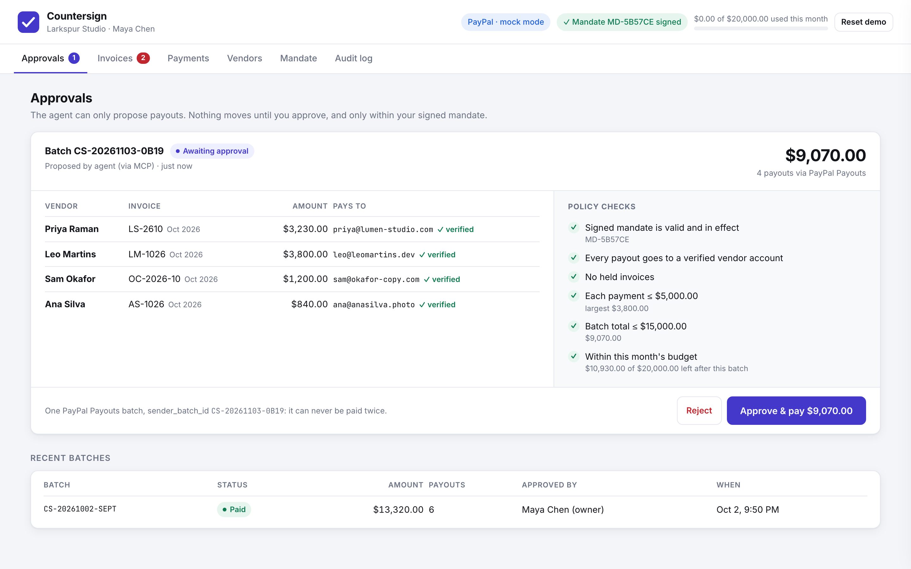

# Countersign

**An MCP server that lets an AI agent pay your contractors through PayPal Payouts, inside a spending mandate you signed, with invoice-fraud checks and a human approval on every batch.**

> The model proposes. The mandate decides. A human approves.

▶ **Demo video:** _add your YouTube link here_ · Built for the [PayPal AI Hackathon 2026](https://paypalaihackathon.devpost.com/)



## Why

Fake invoices and swapped payment details ("business email compromise") cost businesses about **$3 billion** in reported losses in 2025, according to the FBI's Internet Crime Report. Meanwhile AI agents are starting to move money, and an agent that reads invoices can be manipulated by text inside them.

Countersign is built for a small business paying freelancers each month: Claude does the tedious work (reading invoices, matching timesheets, batching payouts, reconciling), while hard guarantees, enforced in code rather than in the model, keep money from going anywhere it shouldn't.

## What it does

1. **Scan.** `scan_invoices` checks every invoice against the vendor registry, contract rates, approved timesheets, payment history and the signed mandate. Each gets a deterministic verdict: `CLEAR`, `REVIEW` or `HOLD`, with findings.
2. **Explain.** Claude tells the owner what's safe and what's held, and why (lookalike domain, payee change, padded hours, duplicate, hidden prompt injection…). It can draft a verification note to the vendor's address on file.
3. **Propose.** `propose_payment_batch` re-runs every check and creates a batch **awaiting approval**. Held invoices are excluded and payees always come from the verified registry.
4. **Approve.** A human approves, either in an in-chat approval form (MCP elicitation, where the client supports it) or in the dashboard. The agent has no tool that can approve.
5. **Pay.** One PayPal Payouts batch is sent, keyed by its own `sender_batch_id` plus `PayPal-Request-Id`, so a retry can never pay twice. Status streams back through PayPal webhooks (with polling as a fallback).
6. **Reconcile.** `reconcile_payments` confirms each payout with PayPal, writes a receipt per payment (linked to the mandate, the approver and the audit-log head) and reports anything unclaimed or failed.

## Safety model

| Guarantee | How it's enforced |
|---|---|
| The agent can't move money on its own | No MCP tool approves a batch. Approval happens only through the dashboard or an MCP elicitation answered by the user. |
| Money only goes to verified accounts | Payout addresses come from the vendor registry, never from invoice text. Only a human can add a vendor or change a payout account (dashboard, with "how did you verify this?" recorded). |
| Spending stays inside the owner's rules | A signed mandate (per-payment, per-batch and monthly limits, allowed categories). Its HMAC signature is verified before every proposal and approval; editing it in the database invalidates it. |
| Invoice text can't steer the agent | Fields are extracted from **visible** text only. Hidden HTML (white or 1px text, `display:none`, comments) is separated and scanned for prompt injection. Tool output wraps invoice content in `<untrusted_…>` tags. |
| No double payments | Atomic status transitions, a unique `sender_batch_id` and the `PayPal-Request-Id` header. A failed submission is retried with the *same* id. |
| Changes are re-checked at the last moment | Approval re-scans the invoices and re-verifies the mandate, budget and payee accounts (e.g. a payout account changed after the proposal blocks approval). |
| Everything is accountable | Append-only, hash-chained audit log (`verify_audit_log`). Receipts embed the chain head. |

## Evaluation

`npm run eval` runs a synthetic set of **40 invoices** (22 legitimate, 18 fraud or policy violations across 17 patterns) through the real pipeline, then runs a **rubber-stamp test**: a naive agent proposes *every* invoice and a careless human approves *every* batch.

| Metric | Result |
|---|---|
| Fraud & policy cases held | **18 / 18** |
| Legitimate invoices payable | **22 / 22** (1 with a warning) |
| False holds | **0** |
| Wrong payments in the rubber-stamp test | **0** |
| Payouts to accounts outside the registry | **0** |

Per-case results: [`eval/RESULTS.md`](eval/RESULTS.md). This is a synthetic set we wrote to cover common invoice-fraud and AI-agent attack patterns; it shows the rules behave as designed and is not a measure of real-world accuracy.

## Quick start (offline, about 2 minutes)

Requires **Node.js 22.13+** (uses the built-in `node:sqlite`).

```bash
npm install
npm run build
npm run seed        # demo story: Larkspur Studio, 6 freelancers, October invoices
npm start           # dashboard at http://localhost:3000, MCP at http://localhost:3000/mcp
```

With no PayPal credentials Countersign uses a built-in PayPal **mock** that returns the same shapes as the Payouts API and emits the same webhook events.

### Connect Claude

**Claude Code** (HTTP, with `npm start` running):

```bash
claude mcp add --transport http countersign http://localhost:3000/mcp
```

**Claude Desktop** (stdio). Add this to `claude_desktop_config.json`, then restart Claude Desktop. The stdio server also starts the dashboard on port 3000 if nothing else is using it.

```json
{
  "mcpServers": {
    "countersign": {
      "command": "node",
      "args": ["/ABSOLUTE/PATH/TO/paypal-mcp/dist/stdio.js"]
    }
  }
}
```

Then try: _"It's month-end. Can you pay October's freelancer invoices?"_ (or use the `month_end_payouts` prompt).

## Connect PayPal sandbox

1. At [developer.paypal.com](https://developer.paypal.com/dashboard/accounts), create a sandbox **Business** account with a large USD balance (e.g. 50,000), and 2–4 sandbox **Personal** accounts to receive payouts.
2. Under **Apps & Credentials** (Sandbox), create an app linked to that business account. In the app's features, make sure **Payouts** and **Transaction search** are enabled. Transaction search can take a few hours to activate.
3. `cp .env.example .env` and set `PAYPAL_CLIENT_ID`, `PAYPAL_CLIENT_SECRET` and `SANDBOX_RECIPIENTS` (the personal account emails).
4. `npm run seed` so the vendors' payout accounts and invoices use those emails.
5. `npm run sandbox:check -- --payout` checks the credentials, balance, reporting, webhooks and recipients, and sends a $1.00 sandbox payout.
6. Optional, for live status updates: deploy (below), set `PUBLIC_URL`, run `npm run sandbox:webhook` and set `PAYPAL_WEBHOOK_ID`. Without webhooks Countersign polls PayPal every 20 seconds.

Log in to [sandbox.paypal.com](https://www.sandbox.paypal.com) as a personal account to see the money arrive.

## Deploy (Render)

`render.yaml` is a Render Blueprint: **New → Blueprint →** this repo. Fill in `PAYPAL_CLIENT_ID`, `PAYPAL_CLIENT_SECRET` and `SANDBOX_RECIPIENTS`. Render generates `DASHBOARD_TOKEN`, `MCP_TOKEN` and `MANDATE_SIGNING_KEY`.

- Dashboard: `https://<app>.onrender.com/` (sign in with `DASHBOARD_TOKEN`)
- MCP: `https://<app>.onrender.com/mcp` with `Authorization: Bearer <MCP_TOKEN>`, or `?token=<MCP_TOKEN>` for clients that can't set headers
- Webhooks: `https://<app>.onrender.com/webhooks/paypal` (signatures verified with PayPal's verify-webhook-signature API)

## MCP tools

| Tool | What it does | Moves money? |
|---|---|---|
| `get_payment_mandate` | Signed limits, signature check, budget left | No |
| `list_vendors` | Verified vendors and payout accounts | No |
| `scan_invoices` | Verdict and findings for every invoice | No |
| `read_invoice` | Full invoice, including hidden text, marked untrusted | No |
| `propose_payment_batch` | Creates a batch awaiting human approval; may ask the user in chat | Only if the **user** approves |
| `get_batch_status` | Live status from PayPal | No |
| `list_batches` / `cancel_pending_batch` | Manage proposals | No |
| `reconcile_payments` | Confirm with PayPal, write receipts | No |
| `payment_history` / `spending_summary` | Ledger and per-vendor totals | No |
| `get_paypal_balance` / `search_paypal_transactions` | PayPal Reporting APIs | No |
| `verify_audit_log` | Recompute the hash chain | No |
| `draft_vendor_verification` | Note to the vendor's address on file | No |

## Architecture

```
 Claude (Desktop / Code / any MCP client)
        │  MCP over stdio or Streamable HTTP
        ▼
 ┌──────────────────────────── Countersign ────────────────────────────┐
 │  MCP tools ──► policy engine (checks.ts) ──► payments.ts ──► PayPal  │
 │                 deterministic, no LLM        propose/approve  client │
 │                        │                     reconcile        (REST  │
 │  Dashboard (human) ────┘   signed mandate     receipts        or     │
 │  approvals · vendors ·     (HMAC)                             mock)  │
 │  mandate · audit                                                     │
 │                   SQLite: vendors · invoices · batches · audit chain │
 └──────────────────────────────────────────────────────────────────────┘
        ▲                                                   │
        └──────── PayPal webhooks (/webhooks/paypal) ◄──────┘
```

PayPal APIs used: OAuth 2.0 client credentials, **Payouts** (`POST/GET /v1/payments/payouts`), **Reporting** (`/v1/reporting/balances`, `/v1/reporting/transactions`), **Webhooks** (register and `verify-webhook-signature`).

```
src/
  mcp/server.ts        MCP tools, prompt, elicitation
  core/checks.ts       policy engine (lookalikes, payee change, timesheets, duplicates, injection…)
  core/payments.ts     propose / approve / PayPal submit / webhooks / reconcile / receipts
  core/mandate.ts      signed spending mandate
  core/audit.ts        hash-chained audit log
  core/email.ts        .eml parsing, visible vs hidden HTML text
  paypal/rest.ts       PayPal REST client
  paypal/mock.ts       offline PayPal with identical shapes and webhooks
  http.ts              dashboard API, /mcp, /webhooks/paypal, live events
public/                approval dashboard (AG Grid) and the demo player
eval/                  40-case synthetic set, runner and results
demo/                  scripted, narrated demo-video recorder
```

## Scripts

| Command | |
|---|---|
| `npm test` | 13 tests: policy engine, audit chain, mandate, full MCP flow, elicitation, HTTP auth, REST client |
| `npm run eval` | Evaluation and rubber-stamp test → `eval/RESULTS.md` |
| `npm run seed` | Reset `./data` to the demo story |
| `npm run screenshots` | Regenerate `docs/screenshots` |
| `npm run demo:capture` | Record a real Claude session with the MCP server → `demo/transcript.json` (Claude Code CLI) |
| `npm run demo:record` | Render the demo video from it (cursor, zooms, narration) → `demo/output/` (macOS `say` + ffmpeg + Playwright Chromium) |
| `npm run sandbox:check` | Validate the PayPal sandbox setup |
| `npm run sandbox:webhook` | Register the webhook and print `PAYPAL_WEBHOOK_ID` |

## Limitations

- **Sandbox only.** Payouts sends from a *business* account and needs PayPal's approval for production use. `live` mode refuses to start unless `ALLOW_LIVE=true`.
- The server's independent parser expects the simple `Field: value` invoice layout used in the demo and eval. Claude can read any format, but only fields the server can verify are paid.
- The mandate is signed with a server-held HMAC key. A production version would use owner-held keys or verifiable credentials, in the spirit of AP2 mandates.
- Single business per deployment. Multi-tenant use would need "Log in with PayPal".

## License

MIT
